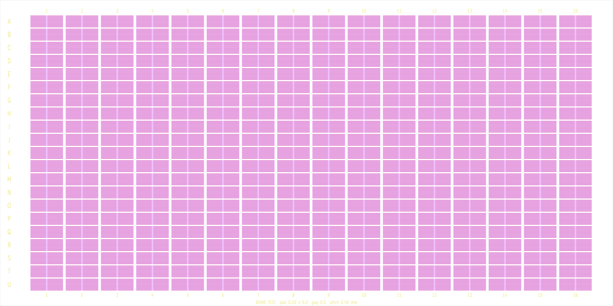

# bonding-test-pcb

Einlagige Testplatine (200 × 100 mm, Querformat) zum Einstellen eines Drahtbonders.
Kein Schaltplan – die Platine wird von `generate_pcb.py` über die KiCad-Python-API erzeugt.



## Layout

| Größe | Wert |
|---|---|
| Pad | 5,0 × 0,10 mm, waagerecht (Breite = JLCPCB-Minimum Leiterbahnbreite, 1 oz) |
| Pärchen | Pad – 0,5 mm Lücke – Pad, entlang x (10,5 mm lang) |
| Abstand benachbarter Pärchen | 0,30 mm → Pitch 0,40 mm (JLCPCB-Minimum wäre 0,15 mm) |
| Tabelle | 21 Zeilen (A–U) × 16 Spalten, 10 Pärchen pro Zelle (übereinander) |
| Gesamt | **3360 Pad-Pärchen** |

Jede Zelle hat eine durchgehende Lötstopp-Öffnung, es liegt also kein Lack zwischen
oder neben den Pads. Zeilenbuchstaben und Spaltennummern stehen im Bestückungsdruck,
z. B. Zelle `C17` für einen Parametersatz.

## Neu erzeugen

Parameter oben in `generate_pcb.py` anpassen, dann:

```sh
python3 generate_pcb.py
kicad-cli pcb drc bonding_test.kicad_pcb
```

## Bestellung (JLCPCB)

- Gerber liegen in `gerber/` (B.Cu ist leer; als 1- oder 2-lagig bestellbar)
- Oberfläche: **ENIG** – HASL ist zum Bonden ungeeignet
- 1 oz Kupfer; 0,10 mm Strukturen liegen am Fertigungslimit, die reale Padbreite
  schwankt durch Ätztoleranz (ca. ±20 %)
